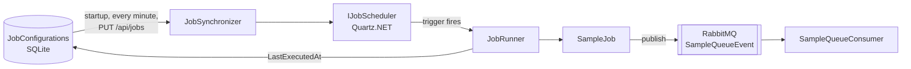

# Dynamic Job Scheduler with Quartz.NET

A .NET 10 template for background jobs whose schedule lives in a database. Quartz.NET runs the jobs and RabbitMQ carries the events they produce.

Change a job's cron or turn it off in the database, or through the API, and the scheduler follows without a redeploy.

> The same template built on Hangfire: [hangfire-dynamic-scheduler](https://github.com/FlipNeves/hangfire-dynamic-scheduler). Both share the domain, persistence, broker and API. Only the scheduler adapter changes, so the two are a side-by-side comparison of Hangfire and Quartz.NET.

## How it works



1. The `JobConfigurations` table is the source of truth: one row per job, with its cron and an active flag.
2. `JobSynchronizer` reads the table on startup, every `Scheduler:SyncInterval` and right after `PUT /api/jobs/{jobId}`. Active jobs get a Quartz.NET job and cron trigger, replaced only when the cron changes. Inactive jobs, and jobs deleted from the table, are removed.
3. When the trigger fires, `QuartzJobRunner` hands the job id to `JobRunner`, which resolves the job from dependency injection, runs it and records `LastExecutedAt`.
4. `SampleJob` publishes a report to RabbitMQ. `SampleQueueConsumer` acknowledges each message it processes and rejects the ones that fail.

## Features

- Schedule stored in SQLite with EF Core, created and seeded on startup
- Jobs API to list jobs with their last and next run, and to change the cron or turn a job on and off at runtime
- Scheduler behind `IJobScheduler`: all Quartz.NET code lives in `Infrastructure/Scheduling`
- RabbitMQ publisher and consumer base class on RabbitMQ.Client 7. Consumers keep retrying while the broker is down, and the API answers 503 instead of failing
- Unit tests for the synchronizer, the runner, the repository and the Quartz.NET adapter

## Quick start

You need the .NET 10 SDK and Docker.

```bash
docker compose up -d
dotnet run --project src/QuartzDynamicScheduler
```

- Swagger: http://localhost:5008/swagger
- RabbitMQ management: http://localhost:15672 (`guest` / `guest`)

Quartz.NET has no built-in dashboard. `GET /api/jobs` shows each job's last and next run.

## Try it

```bash
curl http://localhost:5008/api/jobs

curl -X PUT http://localhost:5008/api/jobs/AnotherSampleJob \
  -H "Content-Type: application/json" \
  -d '{"cronExpression":"* * * * *","isActive":true}'

curl -X POST "http://localhost:5008/api/queue/send?message=12345"

curl -X POST http://localhost:5008/api/queue/send-body \
  -H "Content-Type: application/json" \
  -d '{"name":"Test"}'

curl -X POST http://localhost:5008/api/queue/send-batch \
  -H "Content-Type: application/json" \
  -d '["a","b","c"]'
```

## Adding a job

1. Implement `IJob` from `Domain/Interfaces`, not the Quartz.NET one:

   ```csharp
   public sealed class InvoiceReminderJob : IJob
   {
       public Task ExecuteAsync(CancellationToken cancellationToken)
       {
           return Task.CompletedTask;
       }
   }
   ```

2. Register it in `Program.cs` with `.AddJob<InvoiceReminderJob>()`. The job id is the class name.
3. Insert a row in `JobConfigurations` with `JobId = 'InvoiceReminderJob'`, a cron and `IsActive = 1`. The next synchronization schedules it.

Crons use the standard five fields: minute, hour, day of month, month and day of week (`*/5 9-18 * * 1-5`). Quartz.NET 4 reads them with `CronFormat.Unix`, so the database holds the same values as the Hangfire version.

## Adding a consumer

Add the queue to `QueueEventType`, inherit from `EventConsumerBase`, implement `HandleAsync` and register the class with `AddHostedService<T>()`.

## Project structure

```
src/QuartzDynamicScheduler
├── Configurations/      options and dependency injection
├── Consumers/           RabbitMQ consumers
├── Controllers/         jobs API and queue test endpoints
├── Domain/              entities, interfaces and message models
├── Infrastructure/
│   ├── Broker/          RabbitMQ connection, publisher and consumer base
│   ├── Persistence/     EF Core context, seed and repository
│   └── Scheduling/      Quartz.NET adapter and job runner
├── Jobs/                sample jobs
└── Services/            synchronizer, runner and job catalog
tests/QuartzDynamicScheduler.Tests
```

## Design notes

- Quartz.NET keeps its own state in memory on purpose. The database is the source of truth and the schedule is rebuilt on startup, so a restart only loses the run history. To keep it across restarts and share it between instances, switch to the ADO.NET job store with `UsePersistentStore`.
- The database is created with `EnsureCreated` so the template runs with no setup. Use EF Core migrations in production.
- A failed message is rejected without requeue, so it never loops. Bind the queue to a dead-letter exchange to keep it.
- Quartz.NET does not retry a failed run: the job waits for its next fire time. The Hangfire version retries up to 10 times, its default.

## Tests

```bash
dotnet test
```
